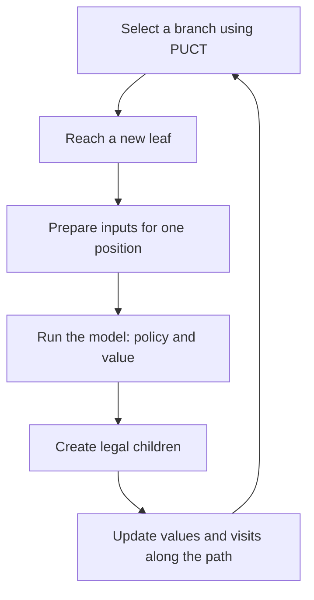

# How the model evaluates positions: predict, predict_on_batch, and tf.function

`predict()`, `predict_on_batch()`, and `model(...)` run the same trained
network. They differ in how they accept data and organize execution.
`tf.function` prepares a computation graph that can be reused. None of these
inference calls updates the model's weights by itself.

Here, the aim is to obtain position evaluations faster so MCTS can use them
in its search. The examples below use the **25×25 Elo arena model**.
The separate application in `main_mcts_ml.py` uses a 30×30 checkpoint.

## 1. What goes into the model?

**Inference** means using a trained model to calculate outputs for supplied
inputs. One sample in this project is one game state.

[`game_state_to_model_input()`](../../ml/predictor.py) prepares two inputs:

| Input | Shape for one position | Contents |
| --- | --- | --- |
| Board | `(1, 25, 25, 5)` | Five maps: my dots, opponent dots, my territory, opponent territory, and legal moves |
| Scores | `(1, 2)` | My score and the opponent's score, divided by the board area |

“My” always refers to the player whose turn it is. The first dimension,
here `1`, is the number of positions in the batch.

The model returns both output heads in one call:

- **`policy`**, shape `(1, 625)`: raw scores for the 625 board intersections.
  These are not yet legal-move probabilities. Our predictor masks illegal
  intersections and applies softmax to the remaining scores.
- **`value`**, shape `(1, 3)`: loss, draw, and win probabilities for the player
  to move. The predictor converts these to the scalar
  `P(win) - P(loss)`.

MCTS uses both outputs to guide its tree search. A model call evaluates a
position; it does not perform the whole search.

## 2. What is a batch?

**A batch is a group of positions passed to the model in a single call.**

```text
batch 1:  [position A]                                      → [evaluation A]
batch 4:  [position A, position B, position C, position D]    → [evaluations A, B, C, D]
```

With batch size 4, the inputs have shapes `(4, 25, 25, 5)` and `(4, 2)`,
and the outputs have shapes `(4, 625)` and `(4, 3)`. Output row `i`
corresponds to input position `i`.

These positions can come from different tree branches or different games.
They do not need to be four consecutive moves. Batch size 4 also does not
mean four CPU cores or four copies of the model.

## 3. Preparing the examples

Run the following snippets in order in a single Python session, started
from the repository root with the project virtual environment active.
They use the existing checkpoint to illustrate the APIs.

```python
import keras
import numpy as np
import tensorflow as tf

from game.enclosure import DotsGame
from ml.predictor import game_state_to_model_input

model = keras.models.load_model(
    "ml/models/25x25_088622_new_data_dual_head_v1.keras",
    compile=False,
)

state = DotsGame(25, 25)
boards, scores = game_state_to_model_input(state)
inputs = (boards, scores)
```

`model` holds the network architecture and loaded weights. `inputs` contains
the data for a particular position. Load the model once, then reuse it for
subsequent evaluations.

### model.predict(inputs)

```python
result_predict = model.predict(inputs, verbose=0)
print(result_predict["policy"].shape)  # (1, 625)
print(result_predict["value"].shape)   # (1, 3)
```

`predict()` manages a dataset: it can divide the inputs into batches, run
inference, and combine the results. It also manages prediction lifecycle
features such as callbacks. `verbose=0` disables progress messages.

This convenience adds overhead. MCTS repeatedly requests an evaluation of
one new position, so preparing each call becomes a noticeable part of the
cost. The [Keras documentation](https://keras.io/api/models/model_training_apis/#predict-method)
describes `predict()` as a dataset-processing API and suggests direct model
calls for small inputs.

### model.predict_on_batch(inputs)

```python
result_batch = model.predict_on_batch(inputs)
print(result_batch["value"].shape)  # (1, 3)
```

You supply **one prepared batch** and receive its outputs. The batch can
contain a single position or many positions. This method does not collect
states from MCTS or wait until, for example, 16 positions become available.

In the inspected TensorFlow backend of Keras 3.15.1, this method uses a
prepared prediction function while bypassing part of the dataset handling
performed by `predict()`. In the tested configuration, Keras wraps that
prediction function in `tf.function` and reuses it.

This explains why **`predict_on_batch()` with batch size 1** was fast:
the improvement came from the inference call path, even though only one
position was evaluated at a time. This behavior was checked in the installed
`keras.src.backend.tensorflow.trainer.TensorFlowTrainer` implementation,
specifically `make_predict_function()` and `predict_on_batch()`.

### model(inputs, training=False)

```python
result_direct = model(inputs, training=False)
print(type(result_direct["value"]))  # TensorFlow tensor
```

This calls the network directly. In our benchmark, this variant ran in the
default **eager** mode: TensorFlow operations were executed as the code ran.
That is why the report calls it `Direct eager`.

In the backend used here, `predict()` and `predict_on_batch()` return NumPy
arrays, while a direct call returns TensorFlow tensors. A tensor is an
object holding data used by TensorFlow. You can obtain its values as a
NumPy array:

```python
value_numpy = result_direct["value"].numpy()
```

Bypassing `predict()` does not automatically execute the entire network as
a prepared graph. In our measurements, the eager call was faster than
`predict()`, but slower than a warmed `tf.function`.

### tf.function

```python
@tf.function(
    input_signature=[
        tf.TensorSpec([None, 25, 25, 5], tf.float32),
        tf.TensorSpec([None, 2], tf.float32),
    ],
    autograph=False,
)
def infer(boards, scores):
    return model((boards, scores), training=False)

result_compiled = infer(boards, scores)
value_numpy = result_compiled["value"].numpy()
```

`@tf.function` is a decorator: it wraps `infer()` in TensorFlow's execution
machinery. On the first compatible call, TensorFlow performs **tracing**:
it builds a graph describing the operations and how data flows between them.
Later calls can reuse that graph, reducing Python's role in dispatching
operations. See the [tf.function guide](https://www.tensorflow.org/guide/function).

You can think of this as preparing an execution plan before running it
repeatedly. Each call supplies new numbers and performs the calculations
using that plan. **The graph is cached, not the board evaluation.**

The first call can be slower because it prepares the graph. That is why
the benchmark warmed each variant before measuring it.

`input_signature` describes the accepted inputs. Each `TensorSpec` declares
a shape and data type. `None` in the first dimension permits different
batch sizes, such as 1, 4, or 16, while retaining the 25×25 board dimensions
and `float32` type. See the [TensorSpec documentation](https://www.tensorflow.org/api_docs/python/tf/TensorSpec).

Without a suitable signature, changes in argument types or shapes can cause
another graph to be built, called **retracing**. Our explicit signature does
not accept 30×30 inputs: this example is intended for the 25×25 model.

`autograph=False` disables automatic conversion of Python control flow,
such as loops and conditional statements. The wrapped function only calls
the model, so that conversion is unnecessary here. The function still runs
as a graph. See the [tf.function parameters](https://www.tensorflow.org/api_docs/python/tf/function).

Create `infer()` once, outside the position-evaluation loop. Recreating it
for each simulation could repeatedly incur graph preparation costs.

## 4. Why does training=False matter?

Our model contains `BatchNormalization` and `Dropout` layers. Position
evaluation needs their inference behavior:

- `BatchNormalization` uses the statistics accumulated during training.
  In training mode, it calculates statistics from the current batch and
  updates moving statistics.
- `Dropout` passes data through without randomly disabling activations.
  Randomly disabling activations is part of its training behavior.

`training=False` selects inference behavior. Setting `training=True` alone
does not run optimizer weight updates, but it can change layer behavior
and normalization statistics. These examples explicitly use `False`.
Sources: [BatchNormalization](https://keras.io/api/layers/normalization_layers/batch_normalization/),
[Dropout](https://keras.io/api/layers/regularization_layers/dropout/).

The standard `predict()` and `predict_on_batch()` paths already use the
model's inference behavior; they do not accept a separate `training=False`
argument from us.

## 5. Passing four different positions

We can use the same `infer()` function with a different batch of inputs:

```python
states = [state]
current = state
for action in [(12, 12), (12, 13), (13, 12)]:
    current = current.move(action)
    states.append(current)

encoded = [game_state_to_model_input(position) for position in states]
boards_batch = np.concatenate([pair[0] for pair in encoded], axis=0)
scores_batch = np.concatenate([pair[1] for pair in encoded], axis=0)

batch_result = infer(boards_batch, scores_batch)
print(batch_result["policy"].shape)  # (4, 625)
print(batch_result["value"].shape)   # (4, 3)
```

The network received four different positions and returned four sets of
outputs. Each position has its own scores and player-to-move perspective.

This only demonstrates the input format. Actual batched MCTS must also
schedule which tree positions to evaluate and route each result back to
the correct node.

## 6. How does this fit into our MCTS?

A simulation currently follows this sequence:



The diagram covers a nonterminal leaf. For a terminal position, the current
code uses the exact game result without running the network.

Switching to `predict_on_batch()` with batch size 1 or to `infer()` can
speed up the model-evaluation step while preserving this sequential order.

**Model batching and search batching are separate tasks.** To send eight
positions to the model together, MCTS must first select eight leaves before
knowing their new evaluations. It needs path reservations, such as virtual
visits, to avoid repeatedly selecting the same pending leaf. When the batch
returns, it must update each selected path.

This delays the feedback used by subsequent PUCT decisions. A large batch
with high model throughput therefore does not guarantee a proportional
MCTS speedup or preserved playing strength.

`tf.function` itself creates neither multiple search processes nor a queue
of leaves. TensorFlow executes operations on CPU or GPU according to its
configuration; our experiment restricted computation to one CPU.

## 7. What did this project's measurements show?

After warm-up in a Linux ARM64 Docker container, using one CPU on an M4 Pro:

| Variant | Positions per call | Positions/s, model only | Simulations/s, complete sequential MCTS |
| --- | ---: | ---: | ---: |
| Current `predict()` | 1 | 45.3 | 41.1 |
| Direct eager call | 1 | 76.9 | 68.3 |
| `predict_on_batch()` | 1 | 202.5 | 149.0 |
| `tf.function` | 1 | 204.2 | 150.6 |
| `tf.function` | 64 | 221.3 | Batched MCTS was not measured |

The last two columns measure different tasks. Model inference evaluates
prepared inputs. A complete simulation also handles game states, branch
selection, child creation, and tree updates. The benchmark also finished
converting both model outputs to NumPy so it measured completed computation.

On this single-CPU setup, reducing inference-call overhead produced the
largest gain. Batch 64 added only about 8% more positions/s over compiled
batch 1, while an individual call took about 289 ms instead of 4.86 ms.

At an equal budget of 1000 simulations, process RAM peaked at about 635 MiB
for the current implementation and 617 MiB for the faster variants. At an
equal 30-second budget, the faster variants reached about 1298 MiB because
they had time to build a larger tree.

Details and measurement limitations:
[throughput report](neural_mcts_single_cpu/REPORT.md),
[RAM report](neural_mcts_single_cpu/MEMORY.md).

## 8. Where is this in the code?

| Location | Purpose |
| --- | --- |
| [`game_state_to_model_input()`](../../ml/predictor.py) | Converts a game state into board and score inputs |
| [`_predict_outputs()`](../../ml/predictor.py) | Validates inputs and uses either `model.predict()` or a supplied inference function |
| [`predict_policy_value()`](../../ml/predictor.py) | Converts network outputs into a legal policy and scalar value |
| [`DualHeadPredictor.predict_state_policy_value()`](../../ml/predictor.py) | Exposes evaluation to MCTS, reusing the model and serializing calls with a lock |
| [`NeuralMonteCarloTreeSearch._run_simulation()`](../../mcts/neural_search.py) | Selects a leaf, obtains its evaluation, and updates the tree |
| [`benchmark.py`](neural_mcts_single_cpu/benchmark.py) | Contains the experimental eager, `predict_on_batch()`, and `tf.function` calls |

`main_mcts_ml.py` now enables `use_tf_function=True` on its predictor.
The startup evaluation warms the graph before MCTS begins, and subsequent
evaluations reuse it. The predictor defaults to `predict()` for other callers.
The results above were measured before this integration, using benchmark
adapters; batch scheduling has not been added to MCTS.

## 9. Similar names with different meanings

| Term | Meaning here |
| --- | --- |
| `model.compile()` | Configures training, including the optimizer, loss functions, and metrics |
| `load_model(..., compile=False)` | Loads a model without restoring its training configuration; inference remains available |
| `tf.function` | Prepares and reuses a graph of TensorFlow operations |
| `jit_compile=True` / XLA | An additional compilation option, not enabled in our `tf.function` |
| Batch | A group of positions passed to the model in one call |
| Worker | A separate executor of work, such as a process; worker count and batch size are independent |
| Position-evaluation cache | Stores completed results for known game states; requires a separate mechanism |

In the report, “compiled inference” refers to our `tf.function` wrapper.
Loading a model with `compile=False` does not prevent preparing that function.
