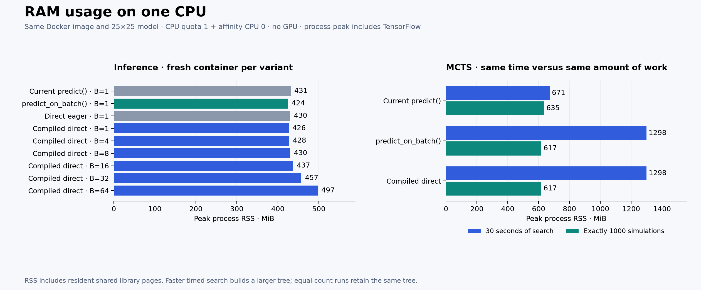

# RAM follow-up: single-CPU Docker benchmark

Single-position inference peaked at 424–431 MiB of process RSS. Compiled batch 64 increased the peak by 70.7 MiB relative to compiled batch 1.

At a fixed search duration, faster inference builds more MCTS nodes and therefore uses more RAM. With a fixed 1000-simulation budget, all three evaluators produced the same root visit distribution and number of tree nodes; compare those rows to separate search size from evaluator overhead.

## Method

- Same Docker image, model, one-CPU quota, CPU 0 affinity, 4 GiB memory cap, no swap allowance, and no GPU as the throughput experiment.
- Every case starts a fresh container and Python process; TensorFlow/Python allocator caches from another variant cannot carry over.
- Inference: three warm-up calls, then five seconds of repeated calls on the same seeded 64-position corpus. Memory peaks include import, model loading, warm-up, and measurement.
- Search: three warm-up calls, then either 30 seconds or exactly 1000 simulations from an empty 25×25 board. These are separate fresh processes, not consecutive searches sharing an allocator.
- One memory run per case. These RAM measurements are a separate follow-up; they do not replace the earlier repeated throughput measurements.
- Primary metric: process peak resident memory, from Linux `getrusage().ru_maxrss`; current RSS and anonymous/file-backed RSS are also saved from `/proc/self/status`.
- Container `memory.current`, `memory.peak`, and anonymous/file/kernel breakdowns are saved separately. Cgroup accounting and process RSS have different scopes: shared library pages can appear in RSS while being charged to another cgroup. Therefore a container peak can be smaller than this process's RSS.
- Values use MiB (1 MiB = 1,048,576 bytes). The 4 GiB cap is a limit, not measured consumption.

## Inference

| Method | Positions/call | Warmed RSS, MiB | RSS after work, MiB | Process peak, MiB | Container peak, MiB |
| --- | ---: | ---: | ---: | ---: | ---: |
| Current predict() | 1 | 426.8 | 431.3 | 431.2 | 208.9 |
| predict_on_batch() | 1 | 423.2 | 424.6 | 424.4 | 202.5 |
| Direct eager | 1 | 423.0 | 430.3 | 430.2 | 211.4 |
| Compiled direct | 1 | 425.6 | 426.6 | 426.5 | 205.0 |
| Compiled direct | 4 | 427.5 | 427.7 | 427.7 | 206.1 |
| Compiled direct | 8 | 429.0 | 430.2 | 430.2 | 208.3 |
| Compiled direct | 16 | 424.7 | 437.3 | 437.3 | 217.2 |
| Compiled direct | 32 | 437.9 | 438.6 | 457.3 | 238.1 |
| Compiled direct | 64 | 454.8 | 454.8 | 497.2 | 275.4 |

## MCTS: 30 seconds per method

| Method | Simulations | Seconds | Tree nodes | Materialized game states | Process peak, MiB | Container peak, MiB | RSS increase during search, MiB |
| --- | ---: | ---: | ---: | ---: | ---: | ---: | ---: |
| Current predict() | 1,212 | 30.00 | 753,850 | 1,212 | 671.1 | 449.8 | 249.4 |
| predict_on_batch() | 4,426 | 30.00 | 2,748,447 | 4,426 | 1297.9 | 1077.8 | 877.9 |
| Compiled direct | 4,426 | 30.00 | 2,748,447 | 4,426 | 1298.3 | 1078.6 | 877.8 |

## MCTS: exactly 1000 simulations per method

| Method | Simulations | Seconds | Tree nodes | Materialized game states | Process peak, MiB | Container peak, MiB | RSS increase during search, MiB |
| --- | ---: | ---: | ---: | ---: | ---: | ---: | ---: |
| Current predict() | 1,000 | 25.15 | 622,315 | 1,000 | 635.0 | 413.8 | 213.3 |
| predict_on_batch() | 1,000 | 6.64 | 622,315 | 1,000 | 617.0 | 395.9 | 197.1 |
| Compiled direct | 1,000 | 6.73 | 622,315 | 1,000 | 616.9 | 395.6 | 196.7 |

## Interpretation

The main memory tradeoff is tree size under a time budget. Each expanded neural node creates a lightweight child for every legal action. Game states are materialized lazily, but the many child-node Python objects still occupy memory.

The same-time memory increase must not be interpreted as the compiled evaluator needing that much additional RAM for one inference. It performs more searches and retains a much larger tree.

The RSS increase during search includes allocator behavior and inference buffers as well as tree objects; it is not an exact standalone byte count of the tree. Garbage collection does not guarantee that Python or TensorFlow returns all freed pages to the operating system. Before/after snapshots are preserved in the raw results.

These runs cover one search from one starting position. They do not establish the maximum RAM usage of a complete long game, multiple concurrent matches, other board dimensions, or different models. A single Docker CPU on an M4 Pro is not an emulation of a particular older processor.

## Artifacts

- [Raw per-stage memory measurements and tree counts](results/memory.json)
- [Isolated-container memory measurement script](memory_benchmark.py)
- [Original throughput report](REPORT.md)

Metric definitions: [Linux process memory fields](https://docs.kernel.org/filesystems/proc.html) and [cgroup v2 memory accounting](https://www.kernel.org/doc/html/latest/admin-guide/cgroup-v2.html).
