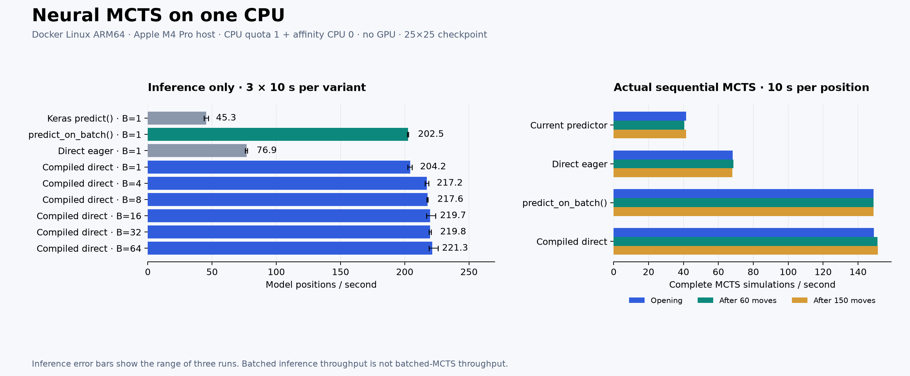

# Neural MCTS: single-CPU Docker benchmark

Measured on 19 October 2026. Production game, MCTS, and prediction code were not changed.

Compiled single-position inference was 4.51× faster than the current `predict()` API. The fastest measured inference configuration, Compiled direct with batch 64, improved throughput by a further 8.4% over compiled batch 1.

For actual sequential MCTS, the fastest measured evaluator was Compiled direct, at 3.66× the baseline throughput across the three tested positions.

For this single-CPU setup, start with low-overhead inference at batch size 1 (`predict_on_batch()` or a compiled direct call). Larger batches offer a smaller additional model-throughput gain and delay tree feedback; their actual MCTS benefit remains unmeasured.

## Environment and method

- Host: Apple M4 Pro; native Linux ARM64 container, without x86 emulation or a GPU.
- Docker limits: `--cpus=1 --cpuset-cpus=0 --memory=4g --memory-swap=4g`.
- Verified from inside the container: affinity `[0]`, cgroup `cpu.max = 100000 100000`, memory limit `4294967296` bytes.
- TensorFlow intra-op/inter-op threads, OpenMP, OpenBLAS, and MKL were limited to one.
- TensorFlow 2.16.2, Keras 3.15.1, NumPy 1.26.4. The full package list is saved in the raw results.
- Checkpoint: `25x25_088622_new_data_dual_head_v1.keras`; 304,772 parameters; unchanged float32 weights.
- Model SHA-256: `0a81599c1601d0a23765b30719d00a6f8b43908583e60b9cf9abde33af5b0020`.
- A seeded corpus contains 64 distinct legal game states, every third move from move 0 through 189, encoded as board and score inputs.
- Every inference variant receives three 10-second measurement windows, with randomized order in each round. Model loading, graph tracing, and warm-up are excluded.
- Each timed call includes conversion of both output heads to NumPy, so asynchronous dispatch alone is not counted as completed inference.
- Inference inputs are prepared before timing. Complete search timings additionally include state preparation, prediction postprocessing, PUCT selection, expansion, and backpropagation.
- A call/search simulation already started at the deadline is allowed to finish. Rates use actual elapsed time, including that overshoot.
- The repository is mounted read-only. The container has no network during measurement; only the results directory is writable.

## Model inference

Totals below are actual completed positions across three windows (approximately 30 seconds). Throughput uses exact elapsed seconds.

| Method | Positions/call | Positions/s | Range across runs | Mean per-run p50 call, ms | Total positions | Actual seconds | Speedup vs predict |
| --- | ---: | ---: | ---: | ---: | ---: | ---: | ---: |
| Keras predict() | 1 | 45.3 | 43.8–47.0 | 21.67 | 1,361 | 30.03 | 1.00× |
| predict_on_batch() | 1 | 202.5 | 202.0–203.0 | 4.88 | 6,077 | 30.00 | 4.47× |
| Direct eager | 1 | 76.9 | 75.8–77.5 | 12.89 | 2,309 | 30.02 | 1.70× |
| Compiled direct | 1 | 204.2 | 202.2–205.8 | 4.86 | 6,127 | 30.00 | 4.51× |
| Compiled direct | 4 | 217.2 | 215.9–218.6 | 18.36 | 6,520 | 30.02 | 4.79× |
| Compiled direct | 8 | 217.6 | 217.1–218.0 | 36.68 | 6,544 | 30.07 | 4.80× |
| Compiled direct | 16 | 219.7 | 217.0–223.9 | 72.52 | 6,608 | 30.07 | 4.85× |
| Compiled direct | 32 | 219.8 | 218.8–220.5 | 145.23 | 6,624 | 30.14 | 4.85× |
| Compiled direct | 64 | 221.3 | 218.9–225.8 | 288.81 | 6,784 | 30.66 | 4.88× |

`Compiled direct` means `model(inputs, training=False)` inside a warmed `tf.function`, with a dynamic batch dimension. XLA, quantization, reduced precision, model compression, and retraining are not used.

`predict_on_batch()` is measured at batch size 1 here: its gain is from the inference API, not from evaluating multiple positions at once.

## Complete sequential MCTS

Each method receives 10 seconds on the same three initial positions: empty board, after 60 moves, and after 150 moves. All methods still evaluate one leaf per call. Experimental in-memory adapters reuse the existing predictor's preprocessing and policy/value conversion.

| Method | Opening sims/s | After 60 moves sims/s | After 150 moves sims/s | Total simulations | Actual seconds | Pooled sims/s | Gain |
| --- | ---: | ---: | ---: | ---: | ---: | ---: | ---: |
| Current predictor | 41.4 | 40.5 | 41.4 | 1,235 | 30.04 | 41.1 | 1.00× |
| Direct eager | 68.2 | 68.6 | 68.1 | 2,051 | 30.03 | 68.3 | 1.66× |
| predict_on_batch() | 149.0 | 149.0 | 149.0 | 4,470 | 30.01 | 149.0 | 3.62× |
| Compiled direct | 149.1 | 151.3 | 151.4 | 4,519 | 30.01 | 150.6 | 3.66× |

## Correctness and limits

All nine inference variants passed numerical comparison against the single-position baseline (`rtol=1e-4`, `atol=1e-5`); maximum observed absolute output difference: `7.6293945e-06`.

All four evaluator variants also produced identical root visit counts and the same selected move in a fixed 32-simulation opening search. This is a sanity check, not a playing-strength evaluation.

Batched rows measure inference only. A batched MCTS scheduler with path reservations has not been implemented or timed, so those rates must not be presented as actual MCTS simulations per second. Delayed feedback and pending-leaf selection can change search quality.

A Docker single-CPU limit restricts available resources; it does not turn an M4 Pro core into an older or slower CPU. These relative results apply to this ARM64 container/runtime, not universally to every processor. Other host workloads and thermal behavior are not controlled. Three samples support a practical comparison, not a formal confidence interval.

Keeping a 30-second move budget increases the number of simulations after optimization. Reducing the budget while retaining playing strength requires separate game comparisons.

## Artifacts and reproduction

- [Raw measurements, environment, package versions, checksums, and correctness checks](results/results.json)
- [Benchmark harness](benchmark.py)
- [Docker image definition](Dockerfile)
- [Core dependency versions](requirements.txt)
- [Reproduction instructions](README.md)

The interpretation of CPU quota and CPU affinity follows [Docker's resource constraints documentation](https://docs.docker.com/engine/containers/resource_constraints/). The alternative inference APIs are documented in [Keras model training APIs](https://keras.io/api/models/model_training_apis/) and [TensorFlow's tf.function guide](https://www.tensorflow.org/guide/function).
